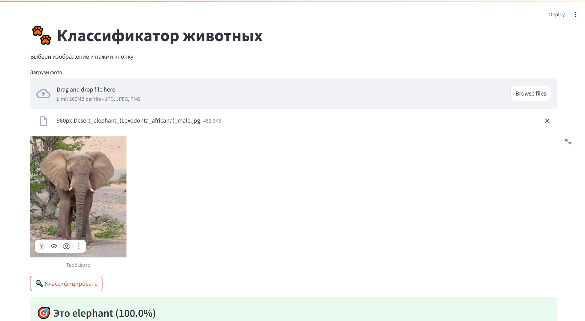

# Классификатор животных

Сравнение трёх нейросетей для классификации изображений животных на пять классов: кошка, собака, слон, лошадь, лев. Лучшая модель доступна через Streamlit и FastAPI.



## Результаты

| Модель | Accuracy | Precision | Recall | F1 |
|---|---|---|---|---|
| Dense | 0.70 | 0.70 | 0.70 | 0.70 |
| SimpleCNN | 0.87 | 0.87 | 0.87 | 0.87 |
| VGGCNN | 0.88 | 0.88 | 0.88 | 0.88 |

Лучший результат у VGG-подобной сети. Полносвязная сеть заметно отстаёт от свёрточных.

## Модели

1. Dense: полносвязная сеть 1024 → 512 → 256 → 5.
2. SimpleCNN: три блока Conv2D и MaxPooling.
3. VGGCNN: четыре блока в стиле VGG, до 512 фильтров.

## Данные

Пять классов, около 2700 изображений на класс для обучения и около 300 для валидации.

## Файлы

- `app.py`: приложение на Streamlit, загружает модель локально.
- `main.py`: API на FastAPI.
- `streamlit_app.py`: Streamlit-клиент, который отправляет изображение в API.
- `model_config.pkl`: список классов и размер входного изображения.
- `requirements.txt`, `packages.txt`, `runtime.txt`: зависимости и версия Python для деплоя.

Веса модели `best_classification_model.h5` в репозиторий не входят из-за размера. Чтобы запустить приложение, файл нужно положить рядом с `app.py`.

## Запуск

```bash
git clone https://github.com/DenisDrobyshev/classification_animals.git
cd classification_animals
pip install -r requirements.txt
streamlit run app.py          # интерфейс, http://localhost:8501
uvicorn main:app --reload     # API, http://localhost:8000
```

## Лицензия

MIT, см. [LICENSE](LICENSE).
